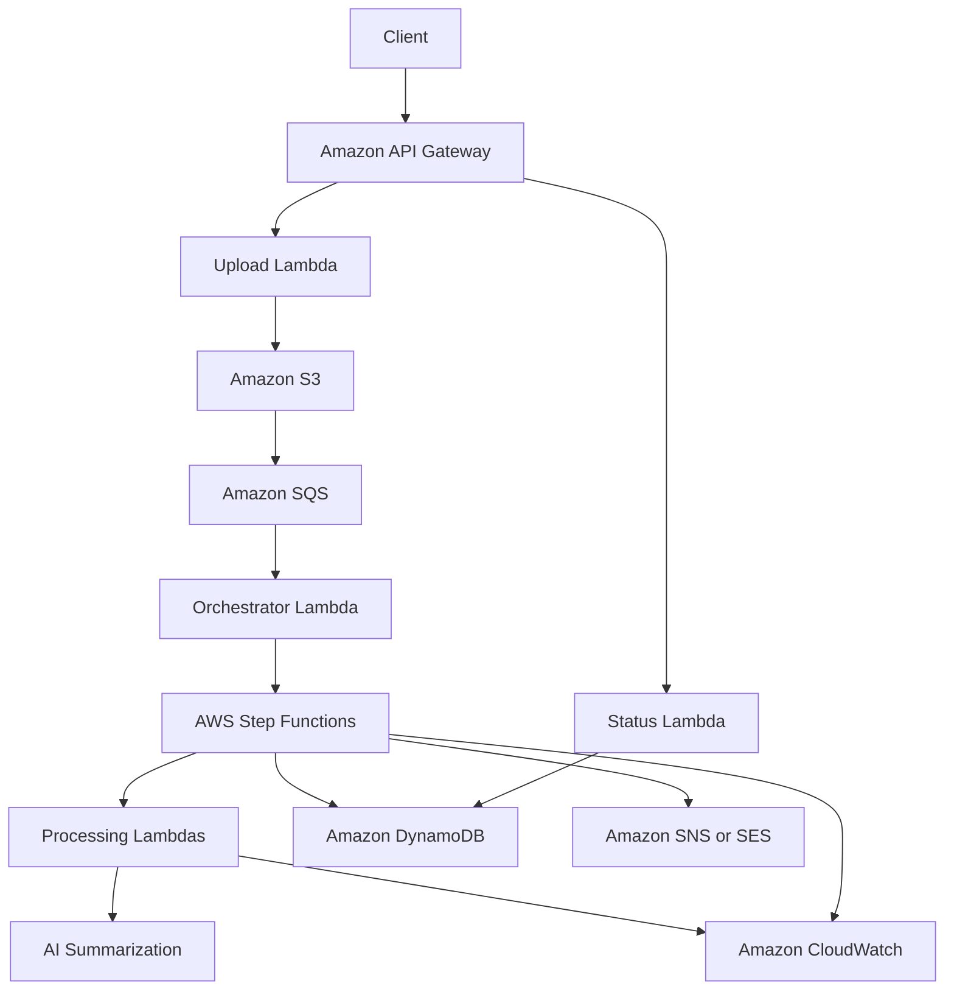

# AWS AI Document Processing & Summarization

[](https://aws.amazon.com/serverless/)
[](https://www.python.org/)
[](LICENSE)
[](#project-status)

A scalable, event-driven AWS serverless API for automated document ingestion, processing, and AI-powered summarization.

The project is designed to accept documents through secure uploads, process them asynchronously, generate concise AI summaries, track every job throughout its lifecycle, and notify clients when results are ready.

> **Project status:** Active development. The repository foundation and initial AWS environment are ready; application code and deployable infrastructure are being added incrementally.

## Table of Contents

- [Overview](#overview)
- [Project Goals](#project-goals)
- [Planned Architecture](#planned-architecture)
- [Target Features](#target-features)
- [Processing Workflow](#processing-workflow)
- [Planned API](#planned-api)
- [Technology Stack](#technology-stack)
- [Roadmap](#roadmap)
- [Security](#security)
- [Getting Started](#getting-started)
- [Testing Strategy](#testing-strategy)
- [License](#license)
- [Author](#author)

## Overview

Traditional synchronous APIs are not ideal for document-processing workloads because extraction and AI summarization can take longer than a normal HTTP request. This project addresses that limitation with a loosely coupled, asynchronous architecture built on managed AWS services.

Clients will upload documents directly to Amazon S3 using short-lived pre-signed URLs. Events will then be placed on Amazon SQS and processed by AWS Lambda. AWS Step Functions will coordinate the workflow, Amazon DynamoDB will store job metadata and results, and Amazon CloudWatch will provide logs, metrics, and operational visibility.

The result is intended to be:

- **Scalable** — independent components can scale with workload demand.
- **Resilient** — queued jobs, retries, and failure handling reduce lost work.
- **Secure** — clients upload without receiving permanent AWS credentials.
- **Cost-aware** — serverless, pay-per-use services minimize idle infrastructure.
- **Observable** — processing state and failures can be monitored end to end.

## Project Goals

- Build a production-oriented serverless document-processing pipeline.
- Support secure and efficient direct-to-S3 uploads.
- Decouple document ingestion from long-running processing tasks.
- Generate useful AI summaries from uploaded documents.
- Expose clear APIs for upload creation, job tracking, and result retrieval.
- Apply least-privilege IAM permissions across all components.
- Add automated testing, Infrastructure as Code, and CI/CD.
- Keep the architecture extensible for future extraction and classification features.

## Planned Architecture



## Target Features

| Feature | Description | Status |
|---|---|---|
| Secure direct uploads | Generate short-lived S3 pre-signed URLs so clients can upload without AWS credentials | In progress |
| Asynchronous processing | Move document jobs through SQS instead of holding an HTTP connection open | Planned |
| Workflow orchestration | Coordinate validation, extraction, summarization, persistence, and notifications with Step Functions | Planned |
| AI-powered summarization | Produce concise summaries from extracted document text using an AI model | Planned |
| Job status tracking | Store states such as `UPLOADED`, `QUEUED`, `PROCESSING`, `COMPLETED`, and `FAILED` in DynamoDB | Planned |
| Result retrieval API | Allow clients to retrieve processing metadata and generated summaries | Planned |
| Failure isolation | Use retries, timeouts, dead-letter queues, and structured error records | Planned |
| Notifications | Notify users or downstream systems when processing succeeds or fails | Planned |
| Observability | Add centralized logs, metrics, alarms, correlation IDs, and workflow tracing | Planned |
| File validation | Enforce supported file types, size limits, metadata validation, and safe object keys | Planned |
| Idempotent processing | Prevent duplicate uploads or repeated events from creating duplicate work | Planned |
| Infrastructure as Code | Provision repeatable environments using AWS SAM, CDK, or Terraform | Planned |
| CI/CD automation | Run tests, security checks, packaging, and controlled deployments through GitHub Actions | Planned |

## Processing Workflow

1. A client requests an upload URL from the REST API.
2. API Gateway invokes the upload Lambda function.
3. The function validates the request, creates a document ID, stores initial metadata, and returns a short-lived S3 pre-signed URL.
4. The client uploads the document directly to the private S3 bucket.
5. The upload event is delivered to an SQS queue for reliable asynchronous processing.
6. A Lambda consumer starts the Step Functions state machine.
7. The workflow validates the document, extracts its text, and sends the content to the configured AI summarization service.
8. Processing status, metadata, errors, and the final summary are written to DynamoDB.
9. The client retrieves the result through the API, with optional completion notifications through SNS or SES.

## Planned API

The final endpoint names may evolve as the implementation grows.

| Method | Endpoint | Purpose |
|---|---|---|
| `POST` | `/documents/upload-url` | Create a document record and return a pre-signed upload URL |
| `GET` | `/documents/{document_id}` | Retrieve document metadata and current processing status |
| `GET` | `/documents/{document_id}/summary` | Retrieve the generated summary after processing completes |
| `POST` | `/documents/{document_id}/retry` | Retry an eligible failed job |
| `DELETE` | `/documents/{document_id}` | Delete a document and its stored metadata, subject to policy |

Example planned upload-url response:

```json
{
  "document_id": "7d20f0b2-8a86-4eb5-9d21-0f5ec779c1c4",
  "upload_url": "https://example-bucket.s3.amazonaws.com/...",
  "expires_in": 900,
  "status": "PENDING_UPLOAD"
}
```

## Technology Stack

| Area | Technology | Responsibility |
|---|---|---|
| API | Amazon API Gateway | Public REST interface and request routing |
| Compute | AWS Lambda, Python | Serverless business logic and processing tasks |
| Object storage | Amazon S3 | Private storage for uploaded documents and generated artifacts |
| Messaging | Amazon SQS | Reliable buffering and workload decoupling |
| Orchestration | AWS Step Functions | Multi-step workflow coordination and retries |
| Database | Amazon DynamoDB | Job state, metadata, summaries, and error details |
| AI | Amazon Bedrock or a pluggable model provider | Document summarization |
| Notifications | Amazon SNS / Amazon SES | Completion and failure notifications |
| Monitoring | Amazon CloudWatch | Logs, metrics, dashboards, and alarms |
| Security | AWS IAM, S3 encryption | Least-privilege access and data protection |
| Automation | AWS SAM, CDK, or Terraform; GitHub Actions | Infrastructure provisioning and CI/CD |

## Roadmap

### Phase 0 — Foundation

- [x] Initialize the GitHub repository.
- [x] Add an MIT license and Python-focused `.gitignore`.
- [x] Configure the local AWS CLI development profile.
- [x] Create and validate the initial S3 development bucket.
- [x] Establish a least-privilege IAM development setup.

### Phase 1 — Secure Document Ingestion

- [ ] Define the initial project structure and configuration layer.
- [ ] Implement the pre-signed upload URL Lambda function.
- [ ] Add document IDs and collision-safe S3 object keys.
- [ ] Validate file type, extension, size, and request metadata.
- [ ] Store initial upload records in DynamoDB.
- [ ] Add unit tests for URL generation and validation rules.

### Phase 2 — Event-Driven Processing

- [ ] Publish S3 upload events to SQS.
- [ ] Implement the SQS consumer and job-state transitions.
- [ ] Configure retry policies, visibility timeouts, and a dead-letter queue.
- [ ] Make processing idempotent against duplicate S3 and SQS events.
- [ ] Add structured logs and end-to-end correlation IDs.

### Phase 3 — Extraction and AI Summarization

- [ ] Extract text from supported document formats.
- [ ] Integrate the selected AI summarization provider.
- [ ] Support chunking and summary aggregation for large documents.
- [ ] Add prompt versioning and model configuration.
- [ ] Store summaries, processing metadata, and token or cost metrics.
- [ ] Handle unsupported, empty, encrypted, or corrupted documents.

### Phase 4 — Orchestration and Public API

- [ ] Model the complete workflow with AWS Step Functions.
- [ ] Implement document-status and summary-retrieval endpoints.
- [ ] Add consistent API responses and error schemas.
- [ ] Add authentication, authorization, throttling, and input validation.
- [ ] Add optional completion and failure notifications through SNS or SES.

### Phase 5 — Production Readiness

- [ ] Define all cloud resources with Infrastructure as Code.
- [ ] Add unit, integration, and end-to-end tests.
- [ ] Configure GitHub Actions for validation and deployment.
- [ ] Add CloudWatch dashboards, alarms, and tracing.
- [ ] Add encryption, retention policies, backups, and lifecycle rules.
- [ ] Run security, load, resilience, and cost tests.
- [ ] Publish architecture decisions, deployment instructions, and API documentation.

## Security

The project is being designed with the following security principles:

- Keep S3 buckets private and block public access.
- Use short-lived pre-signed URLs with limited permissions and expiration times.
- Apply least-privilege IAM roles to every Lambda function and AWS service.
- Encrypt data at rest and in transit.
- Never commit credentials, secrets, account IDs, or sensitive configuration.
- Validate file metadata and enforce upload limits before processing.
- Protect public endpoints with authentication, authorization, and throttling.
- Record security-relevant events without logging document contents or secrets.

> This project is currently under active development and should not yet be used with sensitive or production data.

## Getting Started

The application is not deployable yet. These steps prepare a local development environment for the upcoming implementation.

### Prerequisites

- An AWS account
- AWS CLI v2
- Python 3.12+
- Git
- An AWS CLI profile with development permissions

### Clone the repository

```bash
git clone https://github.com/AhmadAdas21/AWS-AI-Document-Processing-Summarization.git
cd AWS-AI-Document-Processing-Summarization
```

### Create a virtual environment

```bash
python3 -m venv .venv
source .venv/bin/activate
python -m pip install --upgrade pip
```

Dependency installation and deployment commands will be added when the first Lambda function and Infrastructure as Code template are committed.

## Testing Strategy

The planned quality pipeline includes:

- **Unit tests** for validation, state transitions, S3 keys, and service adapters.
- **Integration tests** for S3, SQS, Lambda, DynamoDB, and Step Functions interactions.
- **Contract tests** for API request and response schemas.
- **End-to-end tests** covering upload, processing, summary generation, and result retrieval.
- **Failure-path tests** for duplicate events, throttling, timeouts, retries, and dead-letter handling.
- **Static checks** for formatting, linting, type safety, dependency risks, and leaked secrets.

## License

This project is licensed under the [MIT License](LICENSE).

## Author

**Ahmad Adas**

- GitHub: [@AhmadAdas21](https://github.com/AhmadAdas21)

---

If this project is useful to you, consider giving the repository a star and following its progress.
